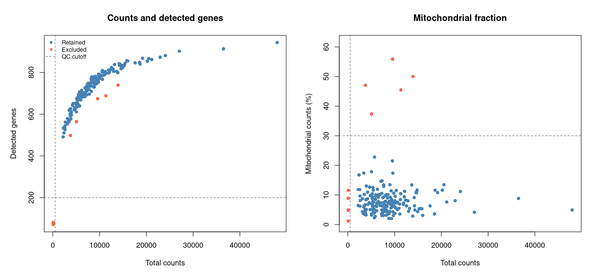

# Preview: Synthetic practice

Plots are saved in `results/synthetic/figures/` as `qc.png` and `pca.png`. Tab-separated tables, including `cell-qc.tsv` and `pca.tsv`, are saved in `results/synthetic/tables/`. The saved R object `normalized.rds` remains in `results/synthetic/`. Supporting files record selected genes, variance explained, parameters, input checksums and the R session.

The two QC panels show counts versus detected genes and counts versus mitochondrial percentage. Blue cells pass all configured cutoffs; red cells fail one or more. Dashed lines show cutoffs. PCA summarizes expression variation among retained cells. Colours show the known simulated populations, not inferred cell types. Nearby points have similar profiles in the selected gene space; separation alone does not identify cell types or demonstrate significance.

After running this example, return here to inspect its generated figures:

**Your task:** identify what each axis measures before interpreting a pattern. Missing images mean the analysis has not generated them yet.

## What the worked result shows

The revised practice retains 190 of 200 cells. Five low-depth cells and five cells with deliberately high mitochondrial fractions fail the configured cutoffs. Read both QC panels: a cell may have enough detected genes but fail the mitochondrial cutoff.

The known simulated populations separate mainly along PC1, with variation within each population. In the checked run, PC1 explains about 5.5% and PC2 about 1.6% of variance in the selected transformed genes. Most variation lies outside these two components. The colours describe how the data were constructed; they are not evidence that this workflow discovered biological cell types.
