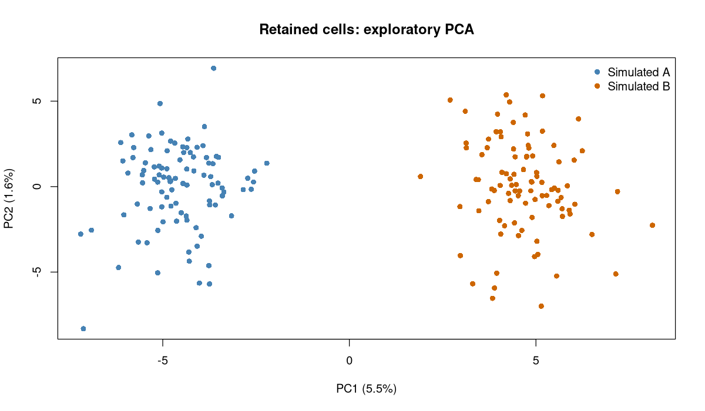

# Preview: Synthetic practice

## Know what you are working toward

You will create a QC table, two figures and a report. Read this page first so the outputs have a purpose; return after Run to inspect your own figures.

| Output | What it helps you answer |
|---|---|
| `results/synthetic/tables/cell-qc.tsv` | Which cells pass the stated QC rules? |
| `results/synthetic/figures/qc.png` | How do count depth, detected genes and mitochondrial fractions vary? |
| `results/synthetic/figures/pca.png` | What expression patterns are visible among retained cells? |
| `results/synthetic/tables/pca-variance.tsv` | How much selected-gene variation does each component capture? |

Supporting files record cutoffs, input checksums, selected genes and software versions. [One workflow for every dataset](../../01-run-the-workflow.qmd) lists all locations.

## Read the QC panels

The left panel compares total counts with detected genes. The right compares total counts with mitochondrial percentage. **Blue means retained; red means excluded by at least one cutoff.** Dashed lines show the cutoffs.

In the checked run, **190 of 200 cells are retained**. Low-depth cells appear near the lower-left of the first panel. The deliberately high-mitochondrial cells can have hundreds of detected genes yet still fail the mitochondrial cutoff. No single panel explains every exclusion.

## Read the PCA

Each point is one retained cell. PC1 and PC2 are weighted combinations of selected, transformed gene expression. Cells close together on these two axes have similar scores in this projection; they may still differ along other components.

The known simulated populations separate mainly along PC1, with variation within each population. In the checked run, PC1 explains about **5.5%** and PC2 about **1.6%** of variance in the selected transformed genes. Most variation is outside this plot. Colours display construction labels; the algorithm did not infer cell types.

## Your task

Point to the axis and metric relevant to each statement: “few detected genes,” “high mitochondrial fraction” and “separated PCA scores.” Write one observation without using “significant” or naming a biological cell type.

**Before moving on:** distinguish an output you expect to create from a result you have actually generated and checked. Missing figures before Run mean that the workflow has not generated them yet.
