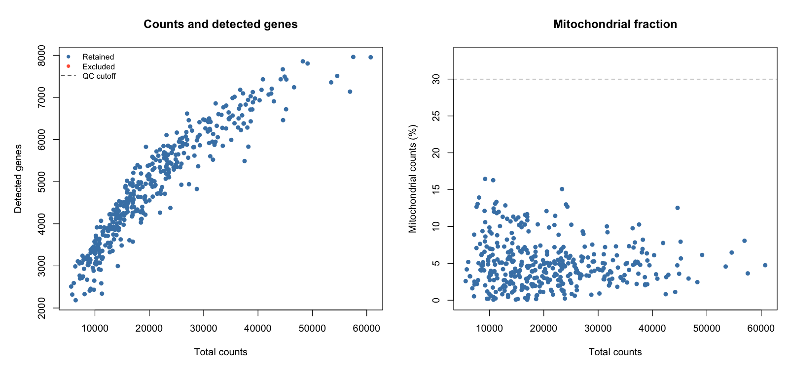
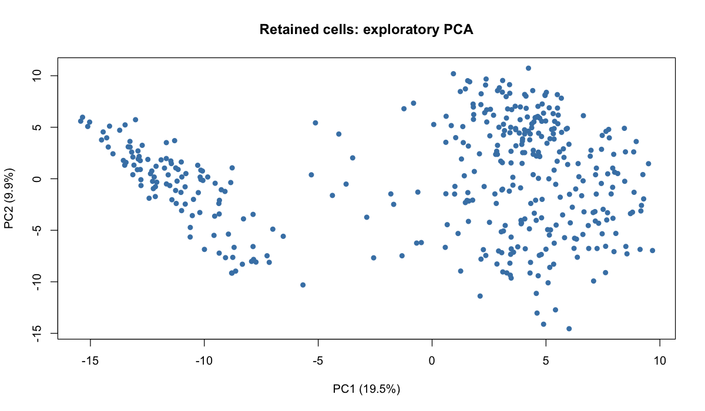

# Preview: Zeisel mouse brain

## Expect variation without assuming identities

The output names and calculations match synthetic practice. The inputs and interpretation change.

| Output | What to inspect |
|---|---|
| `results/zeisel/tables/cell-qc.tsv` | Counts, detected genes, mitochondrial percentage and retention for every exported cell |
| `results/zeisel/figures/qc.png` | Broad variation in depth and whether either QC panel suggests a concern |
| `results/zeisel/figures/pca.png` | Expression variation among the retained cells |
| `results/zeisel/tables/pca-variance.tsv` | Fractions of selected-gene variance captured by PCs |

Run the example first, then return to these figures.

## QC: passing is a specific decision

In the checked run, **all 400 exported cells pass** the illustrative cutoffs. Count totals and detected genes vary widely, and cells with greater count depth generally have more detected genes. The mitochondrial panel provides a separate check; the counts-versus-genes panel alone cannot reveal every QC concern.

“All pass these cutoffs” is a precise result. “All are high-quality cells” would claim more than these checks establish. The exported data are already a processed, published cell dataset, not raw droplets requiring cell calling.

## PCA: structure needs explanation

Each point represents a retained cell. In the checked run, PC1 explains about **19.5%** and PC2 about **9.9%** of variation in the selected transformed genes. The plotted cells occupy separated regions and show variation within those regions. The axes together capture about 29.4%, not all expression variation.

The figure does not label those regions as cell types. Differences could reflect biology, count-related effects or other technical factors; this analysis does not separate those explanations. All points use the same colour deliberately.

## Your task

Write one QC observation and one PCA observation using axis names and a saved number. Then add a limitation that follows from unvalidated donor mapping or the source-order subset. Do not name an apparent group from its position alone.

**Before moving on:** you know which outputs describe QC, which describe transformed expression, and why neither establishes a condition effect.
